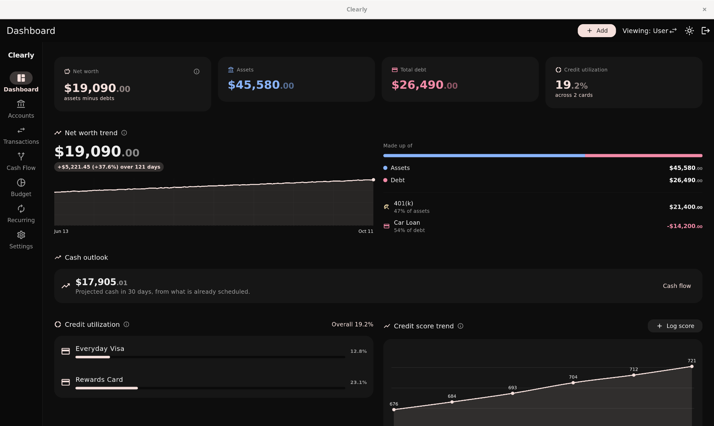
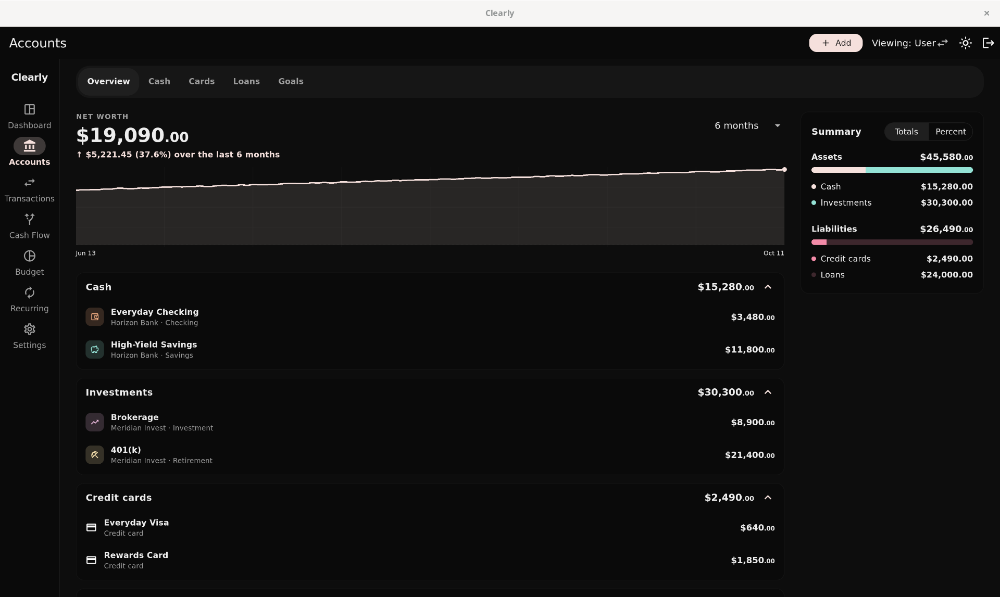
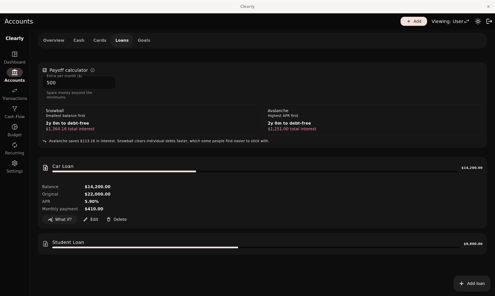
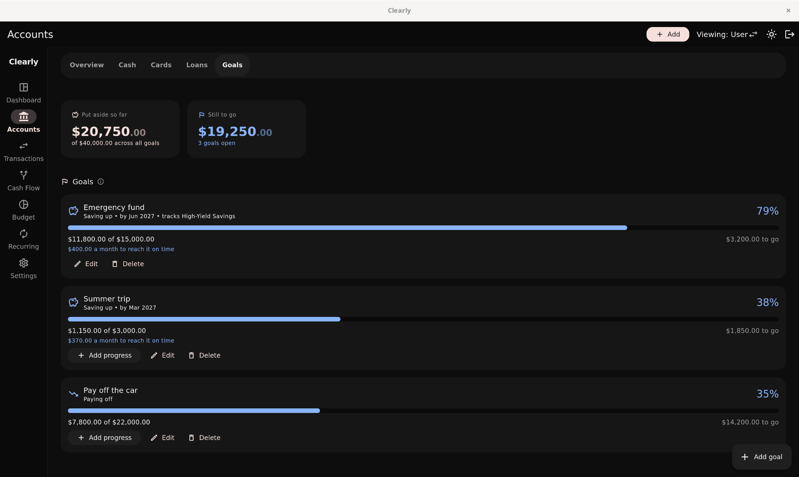
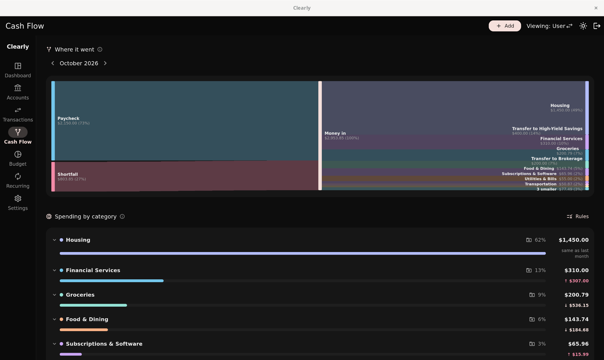
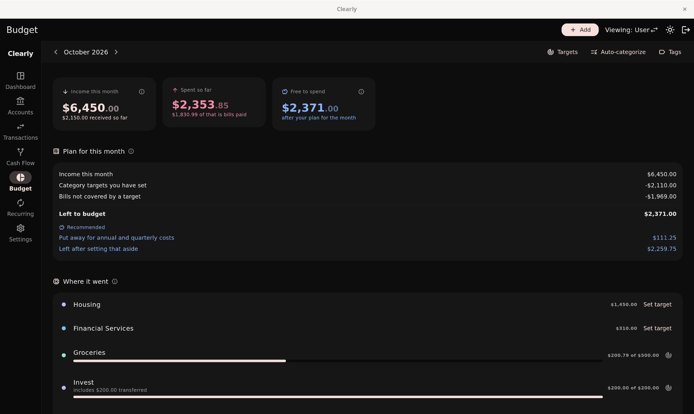
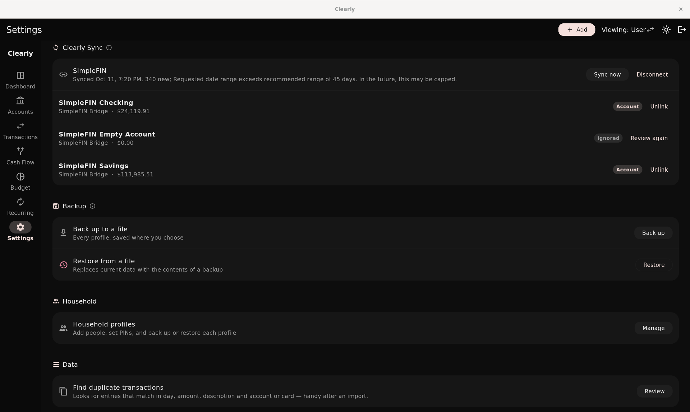
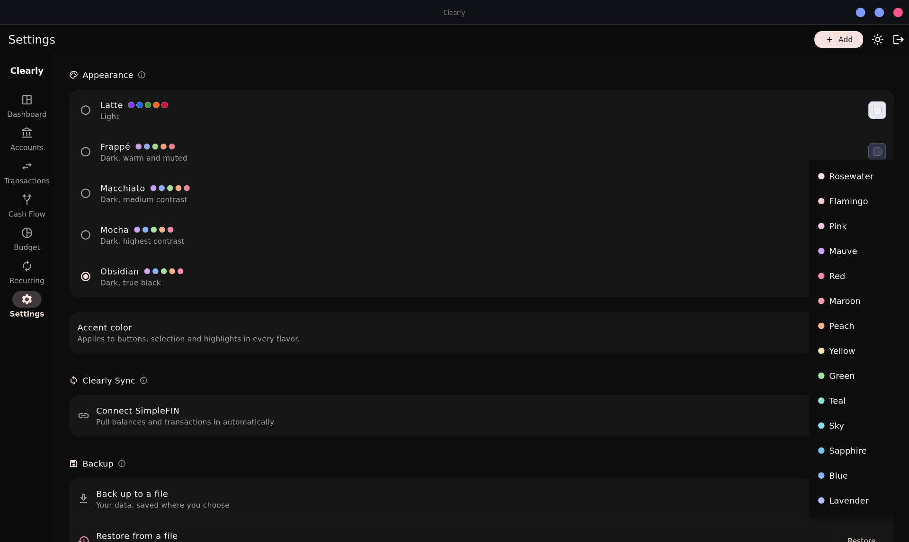

# Clearly

### See clearly.

### [⬇ Download for Linux](https://github.com/psalm2517/clearly-personal-finance/releases/download/v0.6.0/clearly-linux-x64-v0.6.0.tar.gz)

__Knowing your financial health shouldn't cost you $15 a month.__

Clearly is a personal finance app for you and your household, built for the
desktop. It is free and open source. Everything stays on your own computer:
there is no account to make, no server, and nothing is uploaded anywhere.

*All screenshots use generated demo data, not real finances.*

## Why Clearly

- **Free, and nothing to sign up for.** No subscription, no account, no
  company holding your transactions.
- **Optional bank sync that costs $15 a year, paid to SimpleFIN and not to
  Clearly.** Or enter things by hand. It works the same either way.
- **The numbers are right.** A transfer to your own savings, or a card
  payment, is not counted as spending and income. Most apps get that wrong.
- **Simple on the surface.** One Add button for everything, seven pages, and
  nothing you have to configure before it is useful.

## What it does

**Dashboard.** Net worth with its trend and what it is made of, a cash
outlook, credit utilization and a credit score history you log yourself.

**Accounts.** Opens on an overview: net worth over 1 month to all time,
every account, card and loan in collapsible groups, and a summary of assets
against liabilities. The same page has tabs for cash accounts, cards, loans
and goals.

- **Cards** keep balances, limits, utilization and statement cycles.
- **Loans** show payoff progress, a snowball against avalanche comparison,
  and a "what if" with a slider for extra monthly payments that shows the
  interest and time you would save.

- **Goals** are savings or payoff targets with progress, optionally tied to a
  real account's live balance, and the monthly figure to hit the date.

**Transactions.** A full, searchable register across every month. Filter by
account, card, kind, month or tag. A transaction can be split across
categories, and editing one corrects any balance it already moved.

**Cash Flow.** Where the month's money came from and where it went, drawn as
a flow chart, then spending by category, income against spending over six
months, and a projected cash balance 30, 60 or 90 days out that warns you
before it goes negative.

**Budget.** What came in, what went out and what is left for the month.
Set a target for a category and watch it fill. Bills and paychecks are part
of the plan, so every dollar is counted once.

**Recurring.** Upcoming items for the next weeks, bills (monthly, quarterly,
annual or one-time, with autopay), paychecks that generate themselves and
can be split across allocations like rent or savings, scheduled transfers,
and other repeating transactions.

**One Add button.** Expense, income, transfer or card or loan payment from
anywhere. Turn on Repeats and it becomes a bill, paycheck or scheduled
transfer.

## Clearly Sync

An optional mode that reads your accounts through
[SimpleFIN](https://www.simplefin.org/), a read-only bank feed you pay for
directly ($1.50 a month or $15 a year). Clearly itself stays free, and it
works exactly the same by hand without it.

- Paste a SimpleFIN setup token in Settings. Each account the feed reports
  waits for you to add it as an account, card or loan, link it to one you
  already have, or ignore it.
- Once an account is linked the bank is the source of truth for it. The
  balance follows what the bank reports, every transaction is imported once,
  and one you had already typed in is matched to its bank version instead of
  doubled.
- A transfer or card payment that appears on both sides is recorded as one
  movement instead of spending plus income, and brokerage trades are kept out
  of the budget.
- History builds on your own computer, so six months and year to date fill
  in as it runs.
- It is meant to sync once a day, and does so automatically at 1:30 AM while
  Clearly is open. Opening the app does not sync, and Sync now is there when
  you need it.
- Bills, paychecks and repeating transactions no longer add entries beside
  the bank's. A bank transaction marks the matching bill paid or paycheck
  received.

### Categories are yours

There is a set of built-in categories (Food & Dining, Groceries, Housing,
Utilities & Bills, Transportation, Financial Services, Medical & Healthcare,
Personal, Entertainment, Subscriptions & Software, Travel, and a few more),
but nothing is sorted from a built-in merchant list. You make rules like
"SPOTIFY goes to Subscriptions & Software", and they apply to what is
already recorded and to everything that arrives later. A list of
suggestions is there to pick from, and nothing applies unless you choose it.

## Privacy between profiles

A household has multiple profiles. One is an admin, who can view and switch
into any profile. Everyone else sees only their own data and gets no
indication that other profiles exist.

This is enforced structurally, not by hiding UI: every query in the data
layer takes a required `profileId`, and there is no method that returns rows
across profiles. Backups follow the same rule: an admin's backup covers the
household, anyone else's covers only themselves, and restoring a household
backup as a non-admin touches only their own rows.

Profiles can have a PIN of any length using any characters. A PIN is a gate
for convenience, not encryption: the database itself is not encrypted, so
anyone with access to the file can read it.

## Your data

The database lives at:

    ~/.local/share/dev.clearly.clearly/clearly.sqlite

Settings has a backup action that writes a JSON file wherever you choose, and
a restore that replaces the current data. Restore inspects the file and
shows what it contains before doing anything, refuses files from a newer
version before deleting a single row, and copies the live database next to
itself first so a mistaken restore can still be undone by hand.

Backups are plain JSON and are **not encrypted**, which is fine on a local
drive but worth thinking about before putting one in a synced cloud folder.
The bank feed's credentials are never written to a backup.

## Theme

Light and dark, with the [Catppuccin](https://catppuccin.com) flavors, a
true-black Obsidian theme and a choice of accent color, all in Settings.
Colours for the Catppuccin flavors come from the official
`catppuccin_flutter` package rather than being copied into this repository.

## Building

See [BUILD.md](BUILD.md).

## Architecture

    lib/
      data/         Drift schema, repository, bank sync, backup, notifications
      screens/      One file per screen
      widgets/      Shared UI pieces
      theme/        Catppuccin flavors and ThemeData
      util/         Money formatting, payoff maths, PIN hashing

All database access goes through `HomebaseRepository`; widgets never touch
Drift directly. That keeps the per-profile rule in one place.

Schema changes are versioned migrations (currently v25) with tests that
upgrade a real database of each older shape, so existing data survives an
update.

Money is stored as integer cents throughout, never floating point.

## Coming next

- An Investments tab
- Flatpak submission
- The website
- Android build, and eventually Windows and macOS builds

## AI disclosure

This project was built with AI assistance, directed by me.

## License

MIT. See [LICENSE](./LICENSE).
